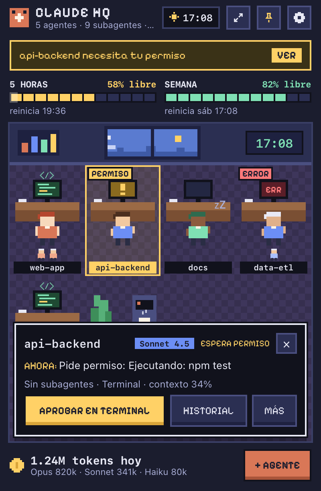
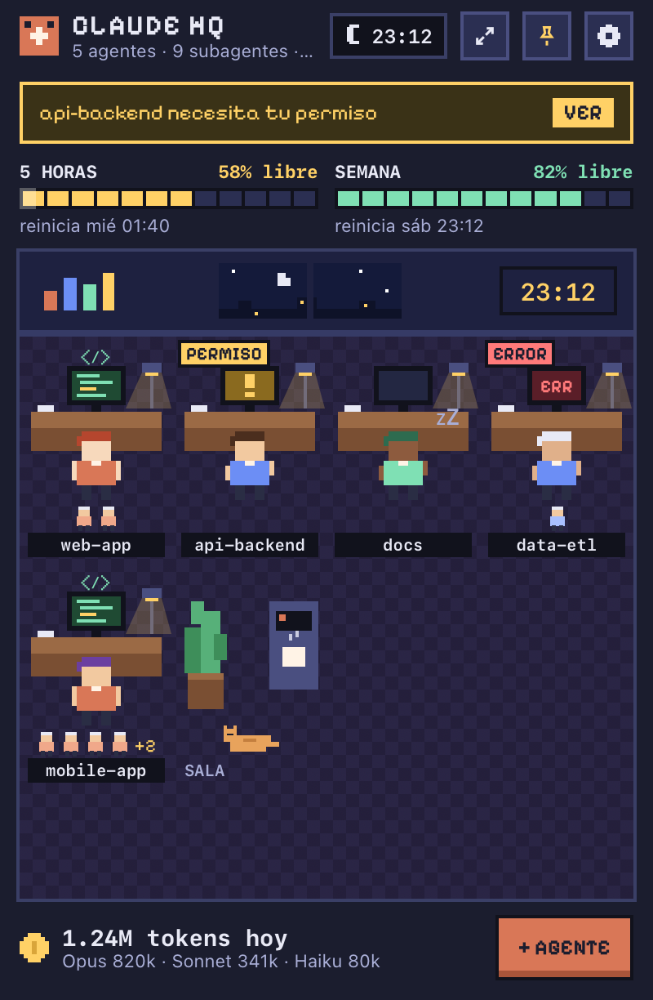
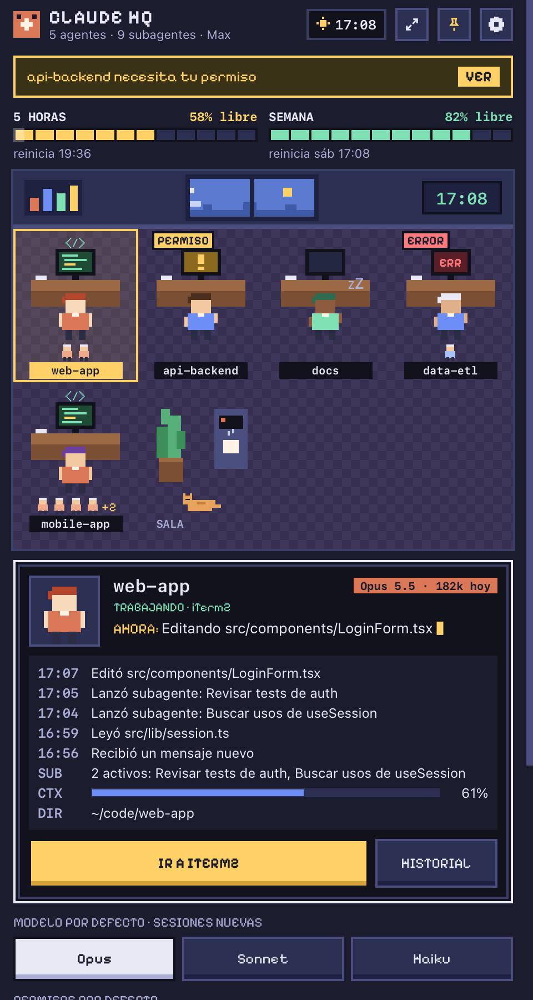
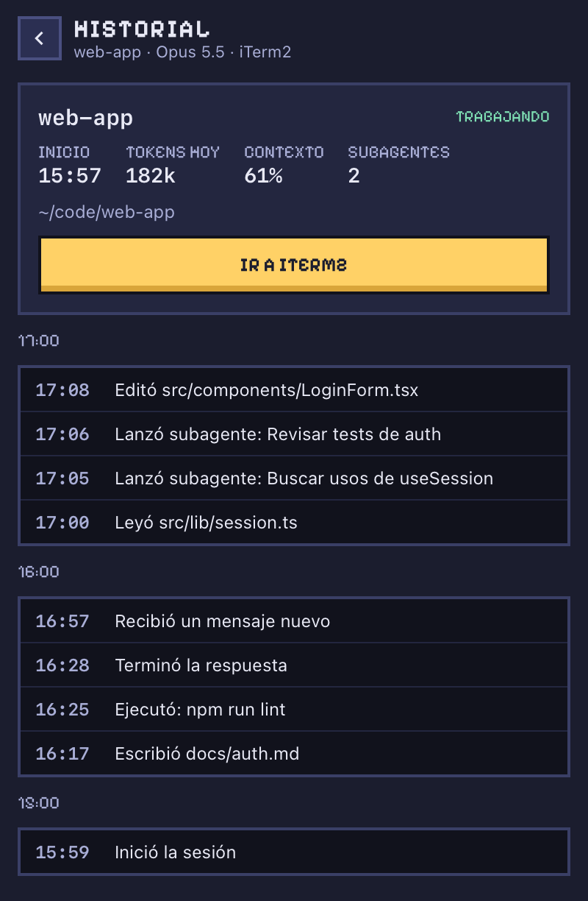
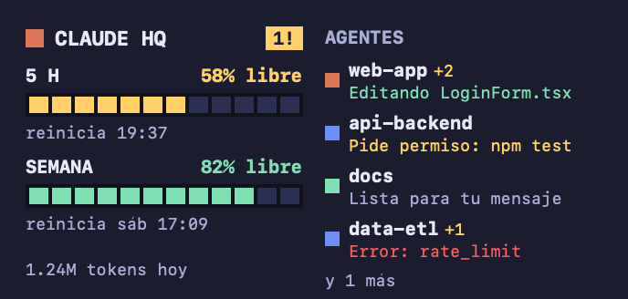
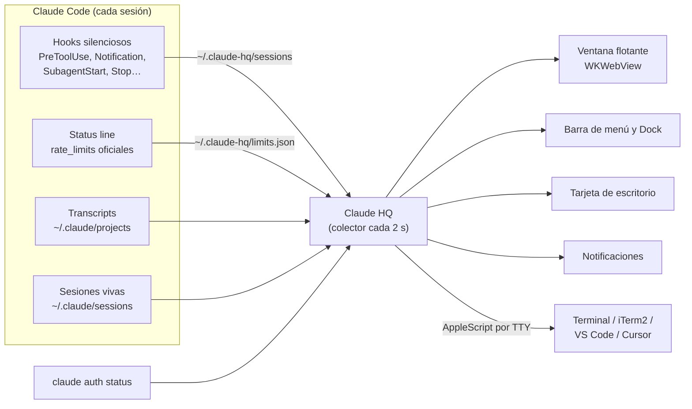

<p align="center">
  
</p>

<h1 align="center">Claude HQ</h1>

<p align="center">
  <b>Tu oficina pixel para Claude Code.</b><br>
  Mira de un vistazo cuánto te queda de tu plan, qué está haciendo cada agente<br>
  y salta a su terminal con un clic. Sin gastar un solo token.
</p>

<p align="center">
  
  
  
  
  
</p>

<p align="center">
  
  &nbsp;&nbsp;
  
</p>

> [!IMPORTANT]
> **¿Eres un agente de IA y te pidieron instalar esto?** No clones ni compiles este repo dentro del proyecto del usuario. Sigue [AGENTS.md](AGENTS.md): un solo comando que instala la app fuera de cualquier proyecto.

---

## Por qué existe

Si trabajas con varias sesiones de Claude Code a la vez, todo pasa escondido en pestañas de terminal: no sabes cuál terminó, cuál está esperando tu permiso ni cuánto te queda de tu ventana de 5 horas hasta que te topas con el límite.

**Claude HQ convierte eso en una oficina que ves de reojo.** Cada sesión es un personaje en su escritorio: teclea cuando trabaja, levanta un letrero cuando te necesita y se echa una siesta cuando termina. Arriba, tus límites como barras de energía.

## Lo que hace

| | |
|---|---|
| 🔋 **Límites reales** | Ventana de 5 h y semanal con el **dato oficial** que Claude Code entrega a la status line, con la hora exacta de reinicio. |
| 🧑‍💻 **Agentes en vivo** | Qué está haciendo cada sesión *ahora mismo* (“Editando src/app.tsx”, “Ejecutando: npm test”), su modelo, su contexto usado y en qué app corre. |
| 👥 **Subagentes** | Aparecen junto a su agente mientras trabajan, con la descripción de su tarea. Sin límite: si son muchos, ves “+N”. |
| 🚪 **Ir a la terminal** | Un clic te lleva a la **pestaña exacta** de esa sesión, aunque esté en otra vista o en otro monitor. |
| 📜 **Historial** | La actividad de cada agente agrupada por hora, con inicio, tokens de hoy, contexto y subagentes. |
| 🔔 **Alertas** | Al 80 % y 95 % de tu límite, cuando un agente pide permiso y cuando una sesión se detiene por error. Con o sin sonido. |
| 🌗 **Día y noche reales** | El cielo sigue tu hora: sol y nubes de día; estrellas, luna y lámparas encendidas de noche. |
| ⚙️ **Atajos** | Modelo y modo de permisos por defecto para sesiones nuevas, abrir una sesión nueva en una carpeta, login con Claude. |
| 💸 **API (opcional)** | Con una Admin API key: gasto del mes en USD y tokens de la API por modelo. |

## Cuatro formas de verlo

<table>
  <tr>
    <td width="50%" valign="top">
      <b>Ventana flotante</b><br>
      Compacta por defecto; se expande para ver la ficha completa del agente, los selectores y la actividad reciente.<br><br>
      
    </td>
    <td width="50%" valign="top">
      <b>Historial por agente</b><br>
      Todo lo que hizo la sesión, agrupado por hora.<br><br>
      
    </td>
  </tr>
  <tr>
    <td valign="top">
      <b>Tarjeta de escritorio</b><br>
      Vive sobre el escritorio, detrás de tus ventanas. Clic para abrir la oficina.<br><br>
      
    </td>
    <td valign="top">
      <b>Barra de menú, Dock y status line</b><br>
      En la barra de menú ves <code>5h 42% · 1!</code> cuando alguien te espera; el ícono del Dock reabre la oficina.<br>
      En Claude Code, tu status line de siempre más el segmento de límites:<br><br>
      <code>… tu status line … │ 5h 42% · sem 18%</code>
    </td>
  </tr>
</table>

## Cómo funciona

Todo se lee **localmente**. Claude HQ no le pregunta nada a Claude, así que no consume tokens.



| Dato | Fuente |
|---|---|
| Límites 5 h y semana | `rate_limits` que Claude Code pasa a la status line |
| Qué hace cada agente y sus subagentes | Hooks que **no imprimen nada** (no agregan contexto a Claude) |
| Sesiones abiertas, modelo y contexto | `~/.claude/sessions` y la status line de cada sesión |
| Tokens de hoy | Transcripts locales (entrada + salida + escritura de caché) |
| Cuenta y plan | `claude auth status`, el mismo login de Claude Code |
| Gasto de la API | Admin API de Anthropic (solo si guardas una key; vive en el Llavero) |

## Instalación

**Requisitos:** macOS 14 o superior, Xcode 15+, [XcodeGen](https://github.com/yonaskolb/XcodeGen) (`brew install xcodegen`) y Claude Code instalado y con sesión iniciada.

Desde cualquier carpeta, en un solo comando:

```bash
curl -fsSL https://raw.githubusercontent.com/JonaRivera-RB/claude-hq/main/scripts/install.sh | bash
```

Clona el código en `~/.claude-hq/src`, compila, instala en `~/Applications` y abre la app. **No escribe nada en la carpeta donde lo corres**, así que es seguro ejecutarlo dentro de otro proyecto o pedírselo a Claude Code desde ahí. Para actualizar, corre el mismo comando.

<details>
<summary>Instalación manual</summary>

Clónalo **fuera** de tus proyectos (no dentro de otro repo):

```bash
git clone https://github.com/JonaRivera-RB/claude-hq.git ~/claude-hq
cd ~/claude-hq
./scripts/build.sh        # compila, instala en ~/Applications y abre la app
```
</details>

Luego, en la app:

1. Toca el aviso azul **CONECTAR**. Agrega los hooks y envuelve tu status line (la que ya tengas se conserva). Antes guarda un respaldo de `~/.claude/settings.json` en `~/.claude-hq/`.
2. Abre o retoma una sesión de Claude Code. En cuanto responda, verás tus límites y su actividad.
3. La primera vez que uses **IR A TERMINAL**, macOS pedirá permiso para que Claude HQ controle Terminal. Dale **Aceptar**.

> **Firma:** `project.yml` usa un equipo de desarrollo personal. Si tu Mac no tiene acceso a ese equipo, `build.sh` compila automáticamente con firma local: la app funciona igual, solo el widget nativo de WidgetKit no carga (la tarjeta de escritorio sí). Con firma local, macOS puede volver a pedir el permiso de Terminal después de cada actualización. Para firmar con tu cuenta, cambia `DEVELOPMENT_TEAM` por el tuyo.

## Uso rápido

| Quiero… | Hago… |
|---|---|
| Ver qué hace un agente | Clic en su personaje |
| Ir a su terminal | **IR A TERMINAL** en el globo, o doble clic en el personaje |
| Ver todo lo que hizo | **HISTORIAL** |
| Ver más detalle | Botón ⤢ (modo expandido) |
| Reabrir la oficina | Ícono del Dock o de la barra de menú |
| Cambiar la tarjeta del escritorio | Clic derecho en la barra de menú → *Widget de escritorio* |
| Desconectar de Claude Code | Ajustes → *Desconectar* (restaura tu status line) |

## Línea de comandos

El mismo ejecutable sirve como herramienta:

```bash
APP=~/Applications/ClaudeHQ.app/Contents/MacOS/ClaudeHQ
$APP install | uninstall                          # conectar o desconectar de Claude Code
$APP dump                                         # estado completo que ve la app (JSON)
$APP focus <sessionId>                            # probar "ir a la terminal" en la app abierta
$APP snapshot out.png [compact|expanded] [js]     # renderizar la interfaz
$APP cardsnap out.png [small|medium] [demo.json]  # renderizar la tarjeta de escritorio
```

El registro de la app está en `~/.claude-hq/app.log`. Para regenerar las capturas de este README con datos de ejemplo:

```bash
D="$(cat scripts/demo-payload.js)"
$APP snapshot docs/img/office-day.png compact "$D; document.querySelectorAll('.tile')[1].click(); 'ok'"
$APP snapshot docs/img/office-night.png compact "window.__demoHour=23; $D; 'ok'"
$APP cardsnap docs/img/card-medium.png medium scripts/demo-snapshot.json
```

## Estructura

```
claude-hq/
├── App/                      App de macOS
│   ├── AppDelegate.swift     Barra de menú, Dock, ventana flotante, alertas, puente con la interfaz
│   ├── DataStore.swift       Junta todas las fuentes en un solo estado
│   ├── HookHandler.swift     `ClaudeHQ hook`: registra la actividad de cada sesión
│   ├── StatuslineHandler     `ClaudeHQ statusline`: guarda límites y encadena tu status line
│   ├── TerminalFocus.swift   Detecta la app de cada sesión y salta a su pestaña
│   ├── TranscriptScanner     Tokens de hoy, incremental
│   ├── Installer.swift       Conecta y desconecta de ~/.claude/settings.json (con respaldo)
│   ├── Services.swift        Login (claude auth), Llavero, Admin API, ajustes de Claude Code
│   └── DesktopWidget.swift   Tarjeta de escritorio
├── web/index.html            La oficina pixel (HTML + CSS + JS, sin dependencias)
├── Widget/                   Extensión WidgetKit (ver notas)
├── Shared/                   Modelos y vistas compartidas
├── scripts/                  build.sh, ícono y datos de ejemplo
└── project.yml               Proyecto de XcodeGen
```

## Privacidad

- No envía tus datos a ningún lado. La única conexión a internet es la Admin API, y solo si guardas una key.
- La Admin API key vive en el **Llavero** de macOS, nunca en texto plano.
- Los hooks son silenciosos y terminan en `|| true`: si la app no está, Claude Code sigue sin errores.
- El texto que llega de tus sesiones se escapa antes de pintarse, así que nunca se ejecuta como HTML.

## Solución de problemas

<details>
<summary><b>“Ir a la terminal” no me mueve de pestaña</b></summary>

Revisa `~/.claude-hq/app.log`. Si la pestaña ya estaba al frente, la app te lo avisa (“Ya estás en la pestaña de…”). Si no tiene permiso: *Ajustes del Sistema → Privacidad y seguridad → Automatización → Claude HQ → Terminal*.
</details>

<details>
<summary><b>No veo mis límites</b></summary>

Se leen de la status line, así que necesitas al menos una sesión que haya respondido después de conectar. Si la app dice “Sin conectar”, toca **CONECTAR**.
</details>

<details>
<summary><b>Una sesión dice “Trabajando…” sin detalle</b></summary>

Se abrió antes de conectar Claude HQ. Su actividad aparece desde su siguiente acción.
</details>

<details>
<summary><b>El widget nativo no aparece en “Editar widgets”</b></summary>

macOS no carga extensiones de WidgetKit firmadas con un equipo de desarrollador gratuito. Por eso la app trae su propia **tarjeta de escritorio**. Con una cuenta de pago, el widget de `Widget/` debería aparecer.
</details>

<details>
<summary><b>Hay un aviso azul “ACTUALIZAR”</b></summary>

Una versión nueva cambió el formato de los hooks. Tócalo para reinstalarlos; tu status line se conserva.
</details>

## Roadmap

- [ ] Notarizar la app para compartirla sin advertencias de Gatekeeper
- [ ] Widget nativo de WidgetKit con una cuenta de desarrollador de pago
- [ ] Versión web en `localhost` para verla desde el navegador
- [ ] Resumen opcional de cada sesión con Haiku (apagado por defecto, porque gasta tokens)

## Créditos

- Fuente [Pixelify Sans](https://github.com/eifetx/Pixelify-Sans) bajo la SIL Open Font License (`web/fonts/OFL.txt`).
- Construido con [Claude Code](https://claude.com/claude-code).

Los cambios por versión están en [CHANGELOG.md](CHANGELOG.md).
